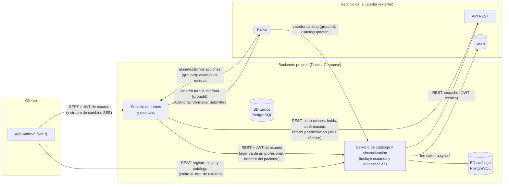
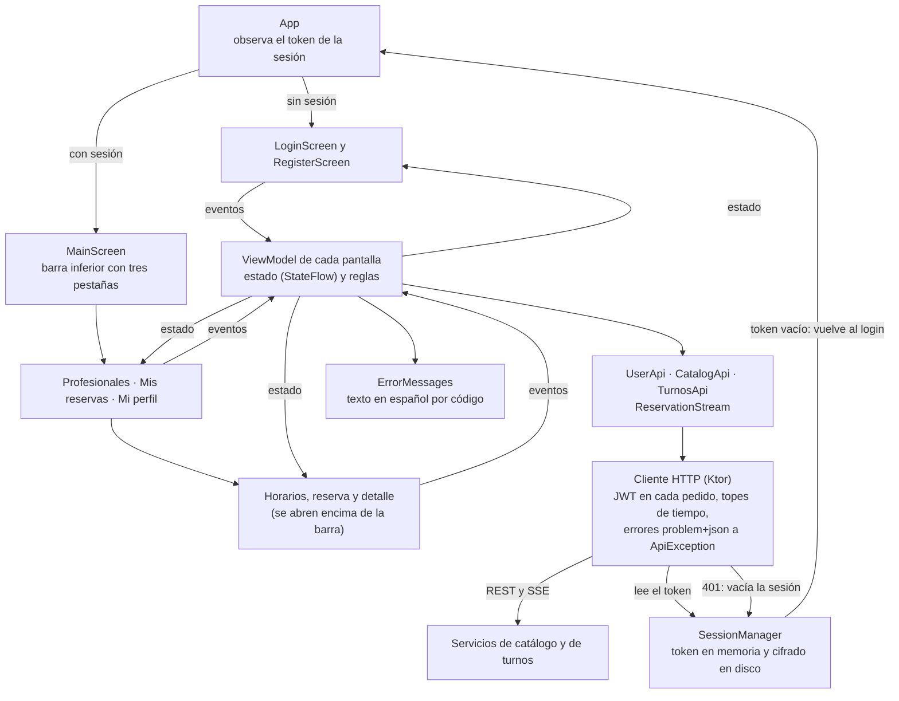
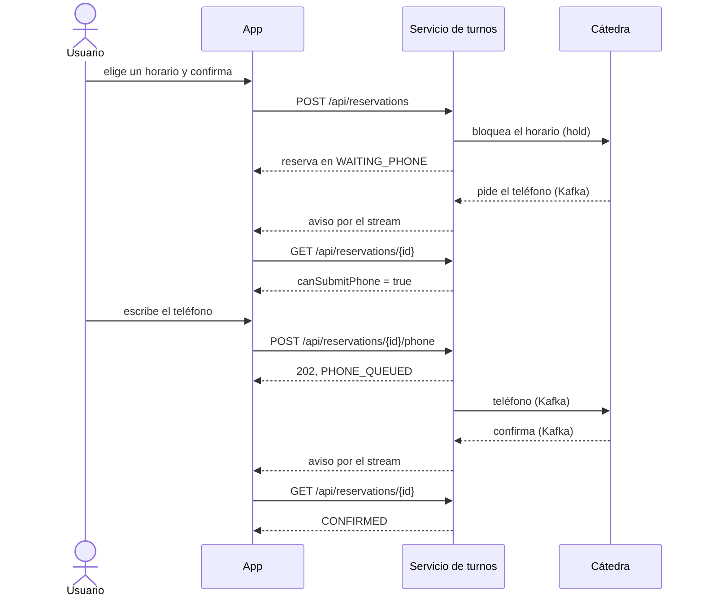

# Arquitectura

Este documento muestra el sistema completo (la aplicación Android, los dos servicios backend, sus bases de datos y las integraciones con la cátedra) y, después, cómo está organizada la app por dentro. El diagrama general es el mismo que usan `ServicioCatalogo` y `ServicioTurnos` en su `docs/arquitectura.md`.

## El sistema

La app es el único cliente de los dos servicios. Se registra e inicia sesión en catálogo, que emite el JWT de usuario; con ese mismo token consulta el catálogo y reserva en turnos. Nunca habla con la cátedra ni conoce el JWT técnico: todo pasa por los servicios.

Qué consume la app de cada servicio:

| Servicio | Operaciones que usa la app |
| --- | --- |
| Catálogo | `POST /api/register`, `POST /api/authenticate`, `GET` y `POST /api/account`, `GET /api/professionals`, `GET /api/professional-categories` |
| Turnos | `GET /api/availability`, `POST` y `GET /api/reservations`, `GET /api/reservations/{id}`, `POST /api/reservations/{id}/phone`, `POST /api/reservations/{id}/cancel`, `GET /api/reservations/stream` |

Los contratos completos (operaciones, DTO, autenticación y errores) están en `docs/contrato.md` de cada servicio.

## La app por dentro

Es una app de un solo módulo (`composeApp`) con el patrón MVVM y flujo de datos en un solo sentido: el estado baja a la pantalla y los eventos suben al `ViewModel` ([decisión 006](decisiones/006-viewmodel-y-pantalla-segun-la-sesion.md)).

- **Una pantalla, un `ViewModel`.** Cada `Screen` de Voyager tiene el suyo y se libera al salir de la pila, así que no hay estado de una pantalla en otra ([decisión 009](decisiones/009-navegacion-con-voyager-y-pantallas-en-clases.md)).
- **Una `XApi` por rebanada de servicio.** Hablan con el cliente HTTP y devuelven modelos; no conocen pantallas ni mensajes.
- **La sesión manda.** `App` observa el token: con sesión muestra `MainScreen`, sin sesión el login. Cerrar la sesión y un `401` pasan por el mismo camino, y el login avisa solo si fue un vencimiento ([decisión 016](decisiones/016-estados-de-error-y-vencimiento.md)).
- **Los errores se traducen en un solo lugar.** El servicio responde un `code` y `ErrorMessages` lo convierte en un texto; nunca se decide por el `detail`.
- **El token no se guarda en claro.** Se cifra con una clave del Android Keystore ([decisión 004](decisiones/004-jwt-cifrado-con-el-keystore.md)) y no se escribe en logs.

## Reservar un turno

Es el flujo más largo. La app no consulta la reserva cada tanto: el servicio avisa cada cambio por el stream y la app vuelve a leer ([decisión 013](decisiones/013-stream-de-cambios-con-reconexion.md)).

Si la reserva vence, falla o se cancela, el aviso lleva a la misma lectura y la pantalla vuelve a los horarios con un mensaje ([decisión 012](decisiones/012-ingreso-del-telefono-sin-cuenta-regresiva.md)).

## Decisiones principales

Cada decisión está completa, con su contexto y consecuencias, en [docs/decisiones](decisiones/README.md). Esta tabla resume qué se eligió y qué se descartó.

| Decisión | Alternativas descartadas | ADR |
| --- | --- | --- |
| Un solo módulo con AGP 8.13 | Dos módulos con AGP 9; AGP 9 con las opciones temporales de compatibilidad | [001](decisiones/001-un-modulo-y-pila-de-versiones.md) |
| URLs por tipo de build, en `gradle.properties` | Constantes en el código; un `.env`; una pantalla de ajustes | [002](decisiones/002-urls-por-tipo-de-build.md) |
| Pruebas acotadas y sin SonarCloud | SonarCloud con cobertura; pruebas de interfaz | [003](decisiones/003-pruebas-acotadas-y-sin-sonarcloud.md) |
| JWT cifrado con una clave del Keystore | `EncryptedSharedPreferences` (deprecada); Tink; texto plano | [004](decisiones/004-jwt-cifrado-con-el-keystore.md) |
| Ktor con CIO, errores `problem+json` y `401` que vacía la sesión | Plugin `Auth` de Ktor; OkHttp; plugin `Logging` | [005](decisiones/005-cliente-http-errores-y-sesion-vencida.md) |
| `ViewModel` de `androidx` por pantalla y contenedor armado a mano | Koin; `ScreenModel` de Voyager; navegar desde cada pantalla | [006](decisiones/006-viewmodel-y-pantalla-segun-la-sesion.md) |
| Lista de profesionales con filtros, páginas y pedidos cancelables | Menú desplegable; buscar al escribir; botón «Cargar más» | [007](decisiones/007-lista-de-profesionales-filtros-y-paginas.md) |
| Turnos en ventanas de 30 días con tope de un año | Sin tope; una ventana fija; chips de 14 y 30 días | [008](decisiones/008-turnos-disponibles-ventanas-de-30-dias.md) |
| Voyager con pantallas como clases con `Content()` | `navigation-compose`; funciones `@Composable` sueltas | [009](decisiones/009-navegacion-con-voyager-y-pantallas-en-clases.md) |
| Paquete propio y CI desde el primer issue | Paquete de un repo de ejemplo; CI al final | [010](decisiones/010-paquete-y-ci-de-la-app.md) |
| Iniciar una reserva con confirmación y consulta antes de repetir | Reservar al tocar; repetir sin consultar; un `Snackbar` | [011](decisiones/011-iniciar-una-reserva-sin-duplicados.md) |
| Ingreso del teléfono sin cuenta regresiva | Cuenta regresiva con `expiresAt`; consultar cada pocos segundos; reenviar el teléfono | [012](decisiones/012-ingreso-del-telefono-sin-cuenta-regresiva.md) |
| Stream de cambios con reconexión propia y comprobación de sesión | Consultar cada pocos segundos; la reconexión del plugin; conexión permanente | [013](decisiones/013-stream-de-cambios-con-reconexion.md) |
| Barra inferior con `TabNavigator` y perfil editable | Barra propia; barra siempre visible; editar solo el nombre | [014](decisiones/014-barra-inferior-y-perfil-de-la-cuenta.md) |
| Mis reservas en dos secciones por día, con cancelación por código de error | Orden del servicio; cargar todo y ordenar; un chip «En curso» | [015](decisiones/015-mis-reservas-y-cancelacion.md) |
| Un mensaje por tipo de falla, el motivo de la reserva y el aviso de sesión vencida | Un solo texto de error; mostrar el `failureReason` crudo; releer al llegar `expiresAt` | [016](decisiones/016-estados-de-error-y-vencimiento.md) |
